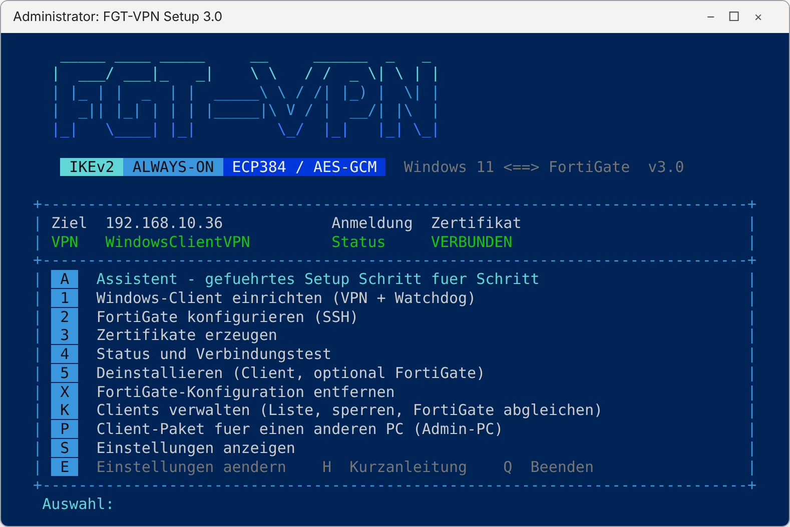
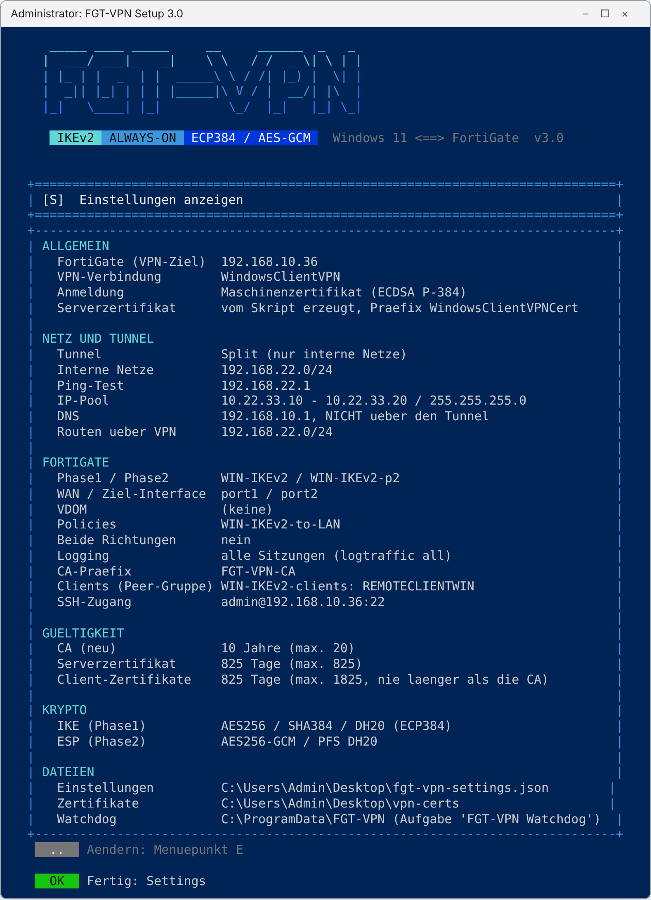
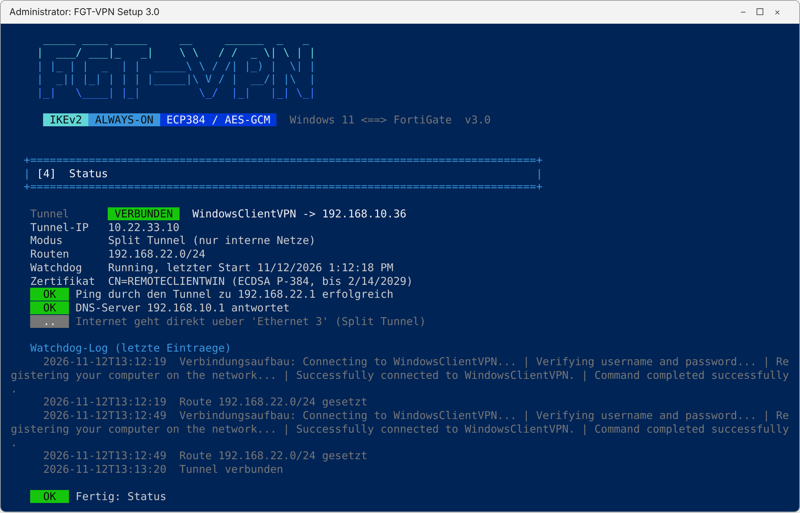
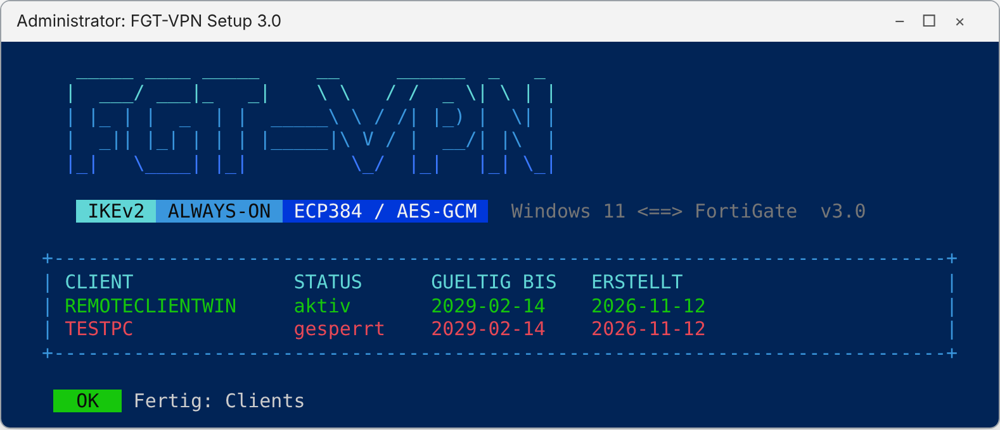

# FGT-VPN Setup

**Always-On-IKEv2-VPN von Windows 11 zur FortiGate – vollständig per PowerShell eingerichtet.**

Ein einzelnes PowerShell-Skript richtet den in Windows 11 eingebauten VPN-Client (IKEv2) und die FortiGate (FortiOS 7.6) passend zueinander ein. Der Tunnel startet als SYSTEM-Dienst beim Booten, also auch **ohne Benutzeranmeldung**, und baut sich bei Abbrüchen selbst wieder auf.



## Funktionen

- **Windows-Bordmittel:** Es wird nichts installiert. Genutzt werden der eingebaute IKEv2-Client, `ssh.exe` (OpenSSH-Client) und die Aufgabenplanung.
- **Starke Krypto:** IKE mit AES-256 / SHA-384 / DH20 (ECP384), ESP mit AES-256-GCM, PFS mit DH20.
- **Eigene CA:**
  - Root-CA (RSA 4096) und FortiGate-Serverzertifikat (RSA 2048)
  - Client-Zertifikate als **ECDSA P-384**, weil Windows das bei ECP384 verlangt
- **FortiGate per SSH:** Das Skript legt an:
  - CA und Serverzertifikat
  - Peer-Gruppe (ein Peer je Client)
  - Adressen, Phase1 und Phase2
  - Policies mit vollem Logging
- **Split oder Full Tunnel**, optional Policies in **beide Richtungen** (LAN → VPN-Clients)
- **Clients sperren:** Ein Peer je PC (CN = Rechnername). Beim Sperren werden Peer und laufende Tunnel entfernt.
- **Client-Pakete für andere PCs:** Der VPN-Client braucht keinen Zugang zur FortiGate. Jedes Paket hat ein eigenes Zufallspasswort.
- **Sicher in der Anwendung:**
  - Sicherung des FortiGate-Stands vor jeder Änderung (`fgt-backups\`)
  - Prüfung der Policy-Reihenfolge (Deny davor?)
  - Aufräumen nicht mehr benötigter Objekte
- **Watchdog:** geplante Aufgabe als SYSTEM. Er setzt nach jeder Verbindung auch die Routen, weil `rasdial` die Profil-Routen nicht anwendet.
- **Deinstallation** des Clients und optional der kompletten FortiGate-Konfiguration
- **Auto-Modus** für Tests und Rollouts (`-Action ... -Auto`)

Die ausführliche Bedienungsanleitung gibt es als PDF: **[docs/FGT-VPN-Setup-Bedienung.pdf](docs/FGT-VPN-Setup-Bedienung.pdf)**

## Voraussetzungen

| | |
|---|---|
| Client | Windows 11 (Pro, Enterprise oder Education), Windows PowerShell 5.1, Administratorrechte (werden per UAC angefordert) |
| FortiGate | FortiOS 7.6 (getestet mit 7.6.8), SSH auf dem Management-Interface, UDP 500/4500 vom Client erreichbar |
| Netz | Der VPN-IP-Pool darf sich nicht mit internen oder lokalen Netzen überschneiden |

## Schnellstart (alles auf einem PC)

1. `FGT-VPN-Setup.ps1` und `Start-FGT-VPN-Setup.cmd` in einen eigenen Ordner legen.
2. **`Start-FGT-VPN-Setup.cmd` doppelklicken** und UAC bestätigen. Alternativ: Rechtsklick auf die `.ps1` und **„Mit PowerShell ausführen“**.
3. Beim ersten Start führt der **Assistent (A)** durch die vier Schritte:
   1. **Einstellungen:** FortiGate-Adresse, interne Netze, IP-Pool, DNS, Interfaces, Tunnel-Modus
   2. **Zertifikate (3):** CA, Serverzertifikat, Client-Zertifikat für diesen PC
   3. **FortiGate (2):** Übertragung per SSH. Das Admin-Passwort fragt `ssh.exe` selbst ab.
   4. **Windows-Client (1):** VPN-Verbindung und Watchdog, danach ein Verbindungstest

Danach steht der Tunnel. Nach einem Neustart verbindet er sich innerhalb etwa einer Minute ohne Anmeldung.

## Menü

| Taste | Funktion |
|---|---|
| **A** | Assistent – geführtes Setup |
| **1** | Windows-Client einrichten (VPN-Verbindung, Krypto, Routen, Watchdog) |
| **2** | FortiGate konfigurieren (per SSH oder als CLI-Datei) |
| **3** | Zertifikate erzeugen (CA, Server, Client für diesen PC) |
| **4** | Status und Verbindungstest |
| **5** | Deinstallieren (Client, optional FortiGate und Zertifikate) |
| **X** | FortiGate-Konfiguration entfernen |
| **K** | Clients verwalten: Liste, sperren, FortiGate abgleichen |
| **P** | Client-Paket für einen anderen PC |
| **S** | Einstellungen anzeigen |
| **E** | Einstellungen ändern |
| **H** | Kurzanleitung |

### Einstellungen anzeigen (S)



### Status und Verbindungstest (4)



### Clients verwalten (K)



## Admin-PC und VPN-Client getrennt

Der PC mit dem VPN muss **keinen** Zugang zur FortiGate haben.

**Auf dem Admin-PC** (mit Zugriff auf die FortiGate):
1. **3** Zertifikate erzeugen
2. **2** FortiGate konfigurieren
3. **P** Client-Paket für den Rechnernamen des VPN-Clients erzeugen. Das Skript zeigt das **Paket-Passwort einmal** an. Gib es getrennt vom Paket weiter.
4. Den neuen Client freischalten: die Rückfrage direkt nach P bestätigen, oder später über **K → 2**

**Auf dem VPN-Client:** `vpn-client-<PC>.zip` entpacken, `Installieren.cmd` starten und das Paket-Passwort eingeben.

Hat auch der Admin-PC kein SSH zur FortiGate, wählst du unter **2** die Option „CLI-Datei“ und fügst die Datei in der FortiGate-CLI ein.

## Client sperren

Unter **K → 1** sperrst du einen Client. Das Skript:
- markiert ihn im Client-Verzeichnis (`vpn-certs\clients.json`) als gesperrt,
- entfernt seinen Peer auf der FortiGate,
- trennt die laufenden Tunnel dieser Phase1. Berechtigte Clients verbinden sich über den Watchdog nach wenigen Sekunden neu.

## Gültigkeit der Zertifikate

Das Skript fragt die Laufzeit beim Erzeugen ab und hält dabei Obergrenzen ein:

| Zertifikat | Vorgabe | Maximum |
|---|---|---|
| Root-CA | 10 Jahre | 20 Jahre |
| FortiGate-Serverzertifikat | 825 Tage | 825 Tage |
| Client-Zertifikate | 825 Tage | 5 Jahre |

Kein Zertifikat ist länger gültig als die ausstellende CA. Status und Client-Liste warnen 30 Tage vor dem Ablauf.

## Auto-Modus (Tests, Rollout)

```powershell
.\FGT-VPN-Setup.ps1 -Action "Certs,Fgt,Client,Status" -Auto -PfxPassword "..." -LogFile C:\temp\vpn.log
```

**Aktionen:** `Menu, Wizard, Help, Settings, Certs, Fgt, FgtRemove, Client, Package, Clients, Peers, Revoke, Status, Uninstall, Purge`

**Weitere Schalter:**

| Schalter | Wirkung |
|---|---|
| `-NewCa` | erzeugt eine neue CA |
| `-ClientName <PC>` | für `Package` und `Revoke` |
| `-MovePolicies` | verschiebt die eigenen Policies vor eine Deny-Policy |
| `-VpnUser` / `-VpnPassword` | Zugangsdaten bei EAP |

Das FortiGate-Passwort fragt `ssh.exe` immer selbst ab.

## Was das Skript anlegt

**Auf der FortiGate** (mit `<P1>` = Name der Phase1, Standard `WIN-IKEv2`):
- `config vpn certificate ca`: `<CA-Präfix>-<id>`
- `config vpn certificate local`: `<Server-Präfix>-<id>`
- `config user peer`: `<P1>-c-<PC>` je Client
- `config user peergrp`: `<P1>-clients`
- `config firewall address`: `<P1>-pool`, `<P1>-lan1..n`, optional `<P1>-dns`
- `config firewall addrgrp`: `<P1>-lan`
- `config vpn ipsec phase1-interface`: `<P1>` (Dial-up, IKEv2, Mode-Config)
- `config vpn ipsec phase2-interface`: `<P1>-p2`
- `config firewall policy`: `<P1>-to-LAN`, optional `<P1>-from-LAN` und `<P1>-to-Internet` (NAT), jeweils mit `logtraffic all`

**Auf Windows:**
- VPN-Verbindung für alle Benutzer mit Zertifikatsfilter auf die eigene CA
- `C:\ProgramData\FGT-VPN\watchdog.ps1` und die Aufgabe „FGT-VPN Watchdog“ (SYSTEM, beim Start)
- Zertifikate im Computer-Speicher: Root-CA und Client-Zertifikat

## Bekannte Grenzen

- **EAP** (Benutzer/Passwort) funktioniert nur als Benutzer-VPN mit Anmeldedialog. Windows reicht EAP-Zugangsdaten bei `rasdial` nicht durch (Fehler 703). Always-On vor der Anmeldung geht nur mit Zertifikat.
- **IPv6:** Der Tunnel ist nur IPv4. Im Full-Tunnel geht IPv6-Verkehr am Tunnel vorbei.
- **DNS über den Tunnel:** Liegt der DNS-Server außerhalb der internen Netze, muss er hinter den Ziel-Interfaces der Policy erreichbar sein.

## Fehler „Ausführung von Skripts ist deaktiviert“

Die Windows-Ausführungsrichtlinie (Standard `Restricted`) blockiert das Skript, bevor es startet. Das Skript kann diesen Fehler daher nicht selbst abfangen. Lösungen, ohne die Richtlinie dauerhaft zu ändern:

- `Start-FGT-VPN-Setup.cmd` verwenden, oder
- Rechtsklick → „Mit PowerShell ausführen“, oder
- in der Konsole: `powershell -ExecutionPolicy Bypass -File .\FGT-VPN-Setup.ps1`

Ist die Richtlinie per Gruppenrichtlinie erzwungen (`Get-ExecutionPolicy -List` zeigt `MachinePolicy`/`UserPolicy`), hilft nur eine Ausnahme durch die IT oder eine signierte Skriptversion.

## Fehlercodes

| Code | Bedeutung |
|---|---|
| 809 | keine Antwort – UDP 500/4500, Adresse oder Phase1-Interface prüfen |
| 13801 | Serverzertifikat: SAN, EKU oder CA passt nicht |
| 13806 | kein passendes Client-Zertifikat (ECDSA P-384 der aktuellen CA?) |
| 13868 | Krypto-Proposals passen nicht |
| 703 | EAP ohne Benutzerdialog (siehe Bekannte Grenzen) |

## Lizenz

MIT – siehe [LICENSE](LICENSE). Nutzung auf eigene Verantwortung. Vor dem Produktiveinsatz bitte in einer Testumgebung prüfen.
